<p align="center"></p>

# DSH Awesome Desktop UI

English | [中文](README.zh.md)

<p align="center"><strong>An Agent workspace with the warmth of a real desk.</strong></p>
<p align="center">Klein blue · Ivory · Quiet motion · A workflow people can follow</p>
<p align="center"><a href="https://github.com/3331060032guoyichen-oss/dsh_awesome_desktop_ui/releases">Downloads</a> · <a href="#video">Video</a> · <a href="#design-references-and-credits">Design references</a> · <a href="LICENSE">MIT</a></p>


An **unofficial desktop UI redesign** of [DeepSeek Harness](https://github.com/deepseek-ai/deepseek-harness). It retains the plugin architecture while connecting the daily steps of opening the app, starting a conversation, waiting for reasoning, and understanding what the Agent did.

The screenshots come from the running client. Account, model, and usage screenshots use demonstration accounts or test data; no personal credentials or actual bills are included in those still images.

## Video

<video controls width="100%" src="https://raw.githubusercontent.com/3331060032guoyichen-oss/dsh_awesome_desktop_ui/v1.0.0/assets/readme/demo.mp4"></video>

[Watch or download the full desktop recording (1:53)](https://raw.githubusercontent.com/3331060032guoyichen-oss/dsh_awesome_desktop_ui/v1.0.0/assets/readme/demo.mp4). Fullscreen is recommended.

## 01 / From whale seal to illustrated desk

<table><tr><td width="50%">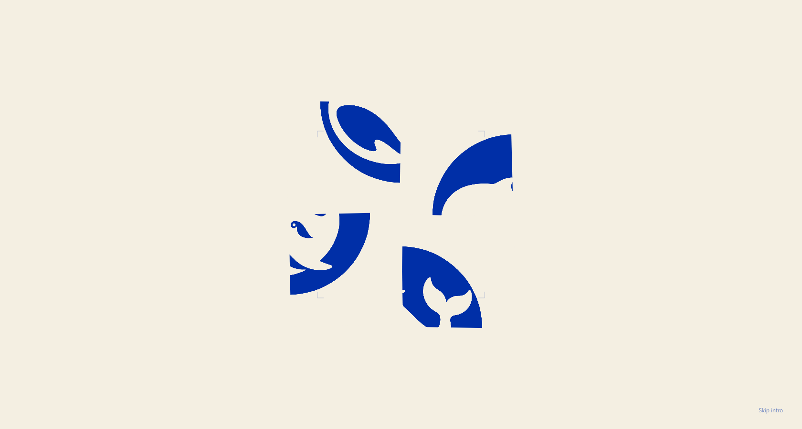</td><td width="50%">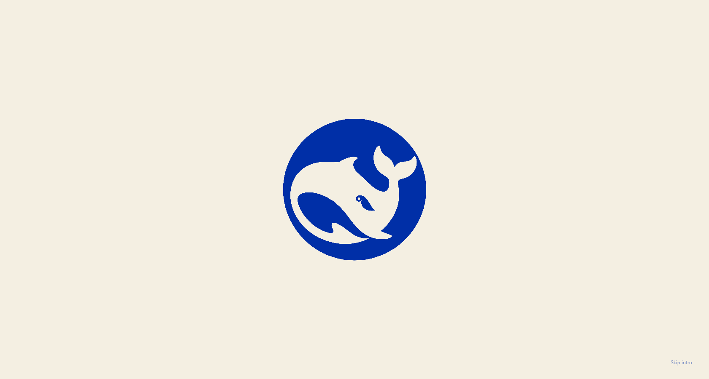</td></tr></table>

The Klein blue and ivory whale seal assembles from four misplaced quarters. Once aligned, the camera approaches the homepage naturally. The opening covers the entire application window, with enough illustration beyond its edges to keep the camera move continuous.

The character mostly stays still, with quiet breathing and occasional independent hair and leaf movements. Pointer parallax is subtle and recenters smoothly; rigid objects such as the pen holder and skyline keep their geometry.

Clicking the manuscript moves the camera forward into an overhead conversation view. Time and scene preferences live in Settings. The sidebar starts collapsed on a fresh launch.

## 02 / A conversation on paper

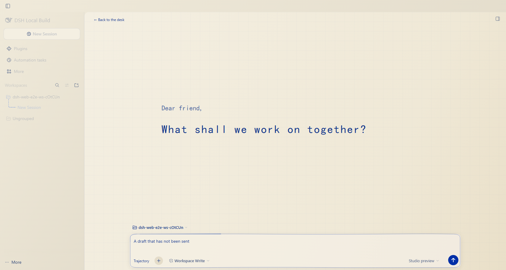

- **Klein blue and ivory throughout**, with a faint manuscript grid.
- **A docked composer**, adjacent Token, cache, and speed information, and independently scrolling conversations.
- **Quiet surface breathing and a traveling fine wave while typing**, keeping the editor and toolbar stable.
- **New conversations stay in the current workspace**, without replaying the opening.
- Body text remains selectable and supports keyboard copying. Reduced motion keeps decorative effects static.

## 03 / An Agent workflow people can follow

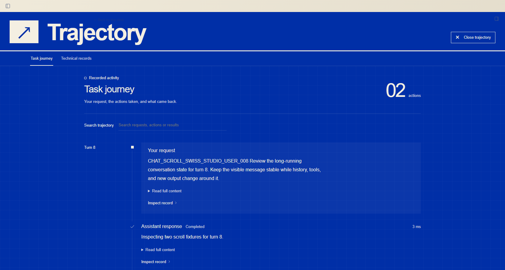

Swiss-inspired hierarchy, generous spacing, and chronological structure make requests, actions, and results readable first. Technical records remain available when someone needs the underlying details.

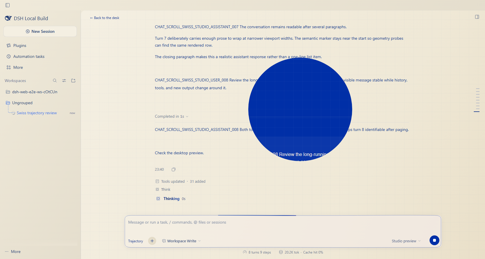

The **pointer reveal** keeps conversation and execution in one space. Its wheel gestures scroll the revealed trajectory rather than moving the whole page. Open the full view from “Trajectory” at the composer's lower left and return with “Close trajectory” at the upper right. The full view has neither an overlaid composer nor workspace Hook lines.

## 04 / Settings belongs to the same design

### Account and usage, together

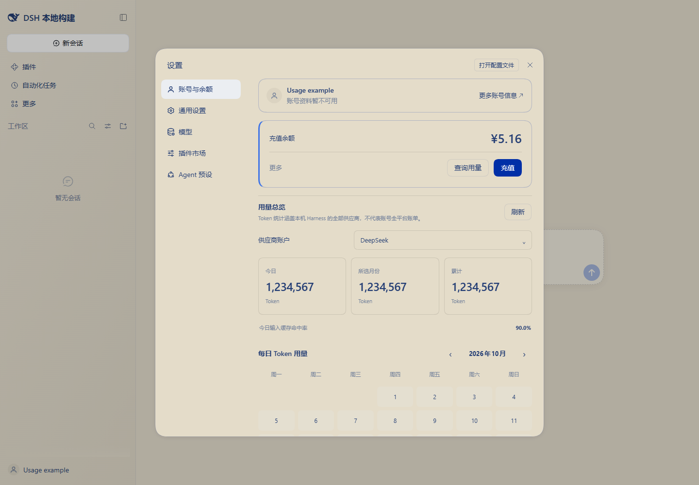

Account details, available balance, daily / monthly / lifetime Tokens, cache hit rate, and the usage calendar live in Settings. Unavailable services display their actual state instead of invented numbers. Extended statistics require the `dsh-usage-stats` service described below.

### Plugin market: search, then choose a scope

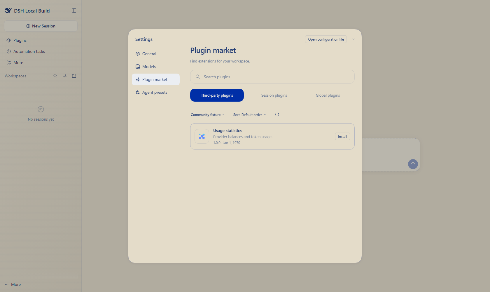

**Third-party / Session / Global** navigation sits below the search field. Switching categories preserves the query. Third-party discovery uses the existing detail, compatibility, and installation flows; Session and Global show their actual inventories. The navigation borrows Gooey Nav's joining and separating rhythm in the desktop's own palette.

### A model wallet that unfolds whenever it opens

<table><tr><td width="50%">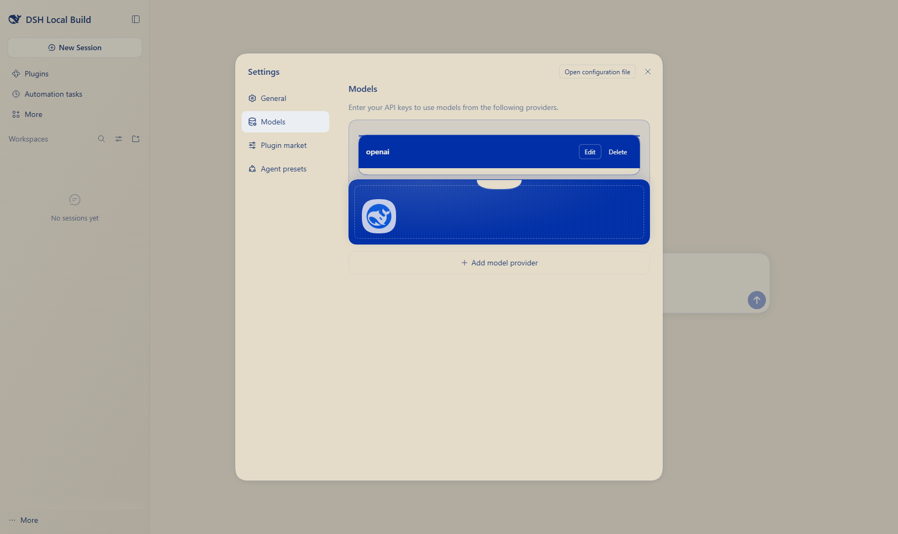</td><td width="50%">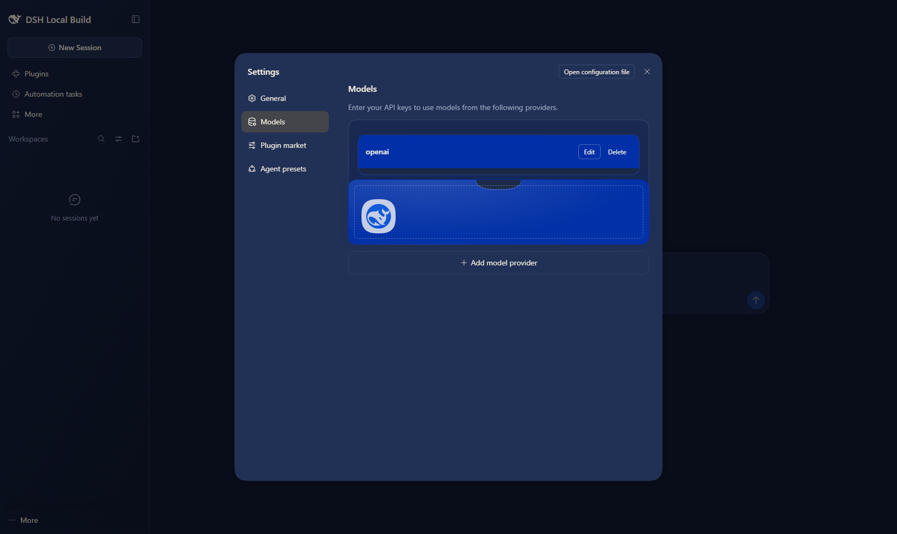</td></tr></table>

The branded sleeve opens first, then the actual provider cards rise and settle in sequence. Editing and deletion retain their existing behavior; the animation is part of the configuration page itself.

Light mode pairs ivory with Klein blue; Dark pairs deep indigo with warm ivory. **Light, Dark, and System all work**, with explicit choices taking priority over operating-system changes.

## 05 / Details you meet every day

| Detail | Experience |
| --- | --- |
| Workspace Hook | Lines connect the specific workspace folder to its conversations, with no intrusion into trajectory pages. |
| Reasoning effort | A Klein blue to violet track, particle density, and speed follow the selected effort. DeepSeek keeps its actual Low / High / Max levels; other providers follow their capabilities. |
| Sidebar | The whole panel gathers and unfolds as pixels, varying between three established accent combinations. |
| Small icons | The plugin windmill accelerates on hover and slows after leaving; the automation clock responds in its own way. |
| Controls | Focus contours match the corners, presses have a tiny displacement, and primary coarse-pointer targets keep 44px sizing. |

<details>
<summary>See Hook, effort, sidebar pixels, and status details</summary>

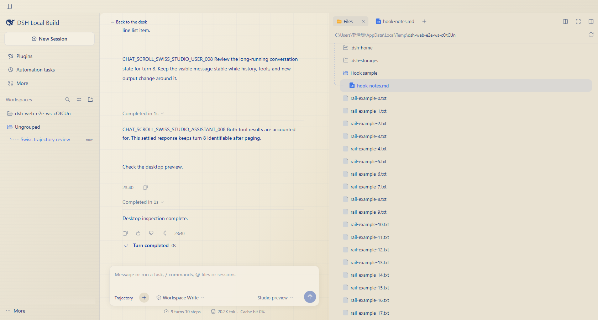
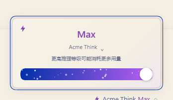
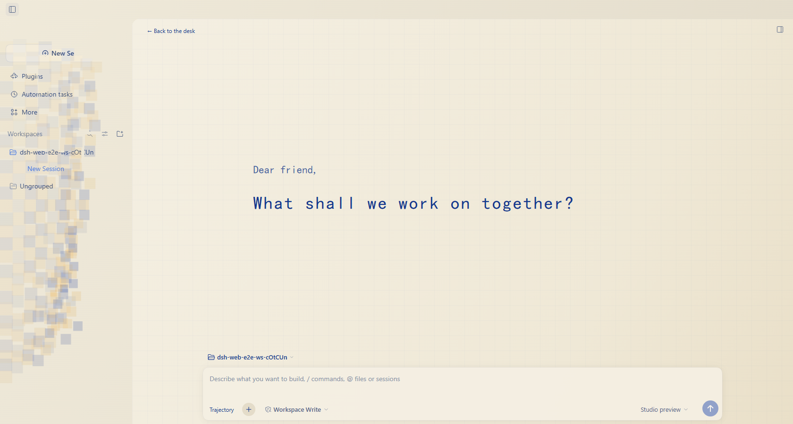
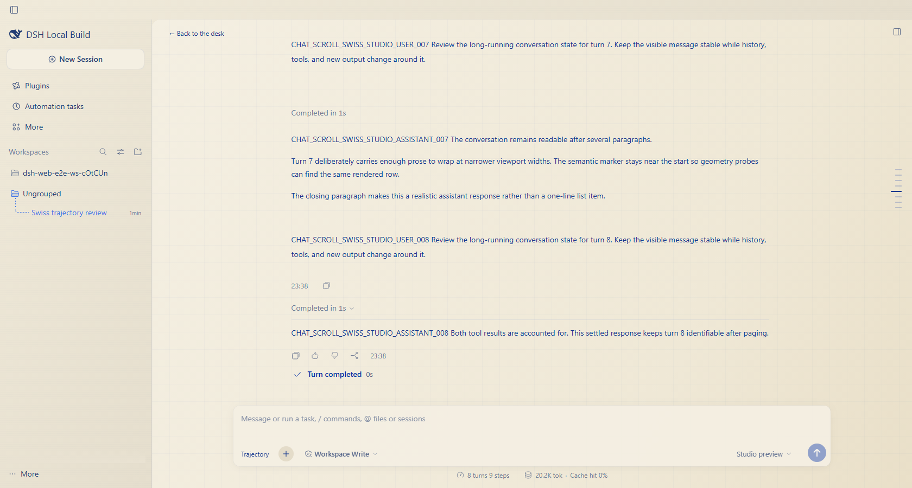

</details>

## Get started

### Windows desktop

Check [Releases](https://github.com/3331060032guoyichen-oss/dsh_awesome_desktop_ui/releases) for available artifacts. If a release includes a Windows x64 `.exe`, download and install it. Source-only releases use the commands below.

Sign in with your own DeepSeek account or configure an available provider in Settings. Accounts, keys, balances, and conversation histories are not distributed as application data.

### Run from source

Use Node.js **24.9+**, Git, and the repository's pinned pnpm. See the [upstream development guide](docs/development.md) for environment requirements.

```powershell
git clone https://github.com/3331060032guoyichen-oss/dsh_awesome_desktop_ui.git
cd dsh_awesome_desktop_ui
corepack enable
pnpm install --frozen-lockfile
pnpm run build
pnpm run start:desktop
```

On Windows x64, [build a standalone community installer](apps/desktop/packaging/README.md#community-windows-installer) with `pnpm run package:desktop:community:win:x64`. This unsigned package bundles its runtimes and uses manual GitHub downloads for updates; **Application → Check for updates** opens Releases.

### Plugins

The project retains Harness's plugin system for conversations, workspaces, files, tools, permissions, and provider settings. **Available tools depend on the enabled deployment plugins.**

- Discovery uses the public [Awesome DSH Plugin](https://github.com/awesome-dsh-plugin/awesome-dsh-plugin) index. Enable the custom plugin index in plugin management; its default URL is `https://cdn.jsdelivr.net/npm/dsh-plugin-catalog/index.json`. Enabling discovery does not install listed plugins automatically.
- Account statistics integrate with [dsh-usage-stats](https://github.com/Ychris12138/dsh-usage-stats). The local demonstration uses its backend adaptation; without the statistics service, account and basic balance remain available while extended usage reports show service status.
- The **UI release is v1.0.0** and the underlying **Harness runtime is 0.2.1-rc.3**. These describe the design release and upstream runtime separately.

## Design references and credits

These references explain both the inspirations and how they were adapted.

| Reference | Adaptation in this project |
| --- | --- |
| [DeepSeek Harness](https://github.com/deepseek-ai/deepseek-harness) | Plugin architecture, provider integration, and desktop runtime. This is an unofficial UI redesign. |
| [illoca](https://illoca.unseen.co/) | Spatial storytelling reinterpreted as a continuous move from the whale seal to desk and manuscript. |
| [Rare UI · Hook Sidebar](https://rareui.com/) | Hierarchy expressed through connecting lines, adapted to workspaces, conversations, and files. |
| [Rare UI · Gooey Nav](https://rareui.com/) | Joining and separating category controls for plugin-market navigation. |
| [Rare UI · AI Status / Grid Reveal](https://rareui.com/) | Activity feedback and progressive reveal, independently implemented around Harness lifecycle events. |
| [Token Pass Intro Animation](https://recent.design/i/poqewfx-token-pass-intro-animation) | The sleeve-first, cards-next entrance using our whale seal and actual provider settings. |
| [Vibe Selector Microinteraction](https://recent.design/i/maajesu-vibe-selector-microinteraction) | Pixel gathering adapted to the complete sidebar, rather than only its toggle icon. |
| [dsh-codex-effort-slider](https://github.com/Microqian2th/dsh-codex-effort-slider) | Effort interaction, with a new brand gradient, particle rhythm, and supported levels. |
| [dsh-usage-stats](https://github.com/Ychris12138/dsh-usage-stats) | Account, balance, usage, and calendar data and presentation. |
| [Awesome DSH Plugin](https://github.com/awesome-dsh-plugin/awesome-dsh-plugin) | Third-party discovery catalog. |
| Swiss graphic design | Trajectory hierarchy, grid, type scale, and spacing. |

The whale assembly, homepage, natural idle state, constrained parallax, manuscript transition, pointer reveal, themes, and composer waves were customized as one desktop experience. Illustration and whale assets were produced through this project's design process; reference-site promotional artwork is not redistributed.

## Development and feedback

Report display sizes, theme, animation, and interaction problems through [Issues](https://github.com/3331060032guoyichen-oss/dsh_awesome_desktop_ui/issues). Include the system, window size, and a screenshot when possible.

Component checks, key page flows, and build checks have run. Windows installation and live providers still require validation with the actual package and environment. See the [upstream documentation](https://github.com/deepseek-ai/deepseek-harness#readme) for the underlying Harness.

## License

[MIT](LICENSE), retaining upstream and dependency notices. Design references describe inspiration and sources; they do not imply participation or endorsement.
